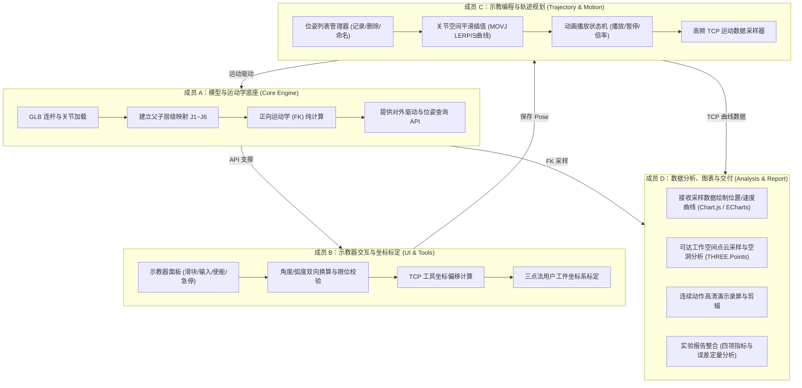
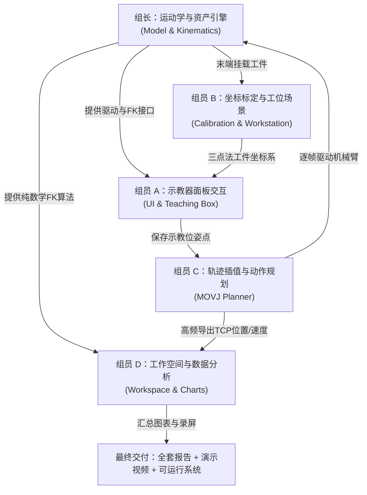

# 机械臂仿真小组作业多人合作与分工指南

- **项目归属**：《图形与动画》课程实验一（机械臂仿真）
- **归档日期**：2026-10-23

---

## 1. 为什么该作业天然需要多人合作？

本实验虽然表面上是一个 WebGL/Three.js 交互网页，但其实质是一套**软硬件跨学科仿真系统**，融合了四个不同方向的技术栈：
1. **三维计算机图形学**：模型资产解析、场景层级树（Scene Graph）、局部/世界变换矩阵、材质光照与视锥体控制。
2. **机器人学与数学计算**：正向运动学（FK）、齐次变换矩阵相乘、工具/用户坐标系矩阵标定（三点法）、工作空间蒙特卡洛采样点云。
3. **前端工程与状态交互**：响应式示教器 UI、关节限位双向数据绑定、急停与使能状态机。
4. **控制与数据可视化**：关节空间插值算法（MOVJ 轨迹平滑）、时间切片采样、位置/速度动态图表绘制与实验报告撰写。

单人完成不仅工作量极其饱和（容易卡在某个细节导致全盘延期），而且无法体现系统工程的模块化架构思维。多人协作通过**清晰解耦与接口契约**，能实现并行开发并高质量交付。

---

## 2. 四大核心协作切入点与职责拆解



---

### 合作切入点 ①：运动学引擎 vs 示教器 UI（前后端解耦）
- **合作痛点**：写界面的组员不知道机械臂关节具体绕什么轴转；写模型的组员界面调不好看。
- **合作解耦**：
  - **成员 A（模型与运动学）** 封装独立类 `RobotController`，暴露纯净的方法：
    - `setJoints([j1, j2, j3, j4, j5, j6])`：设置弧度。
    - `getTCPPose()`：返回 `{ position: {x,y,z}, rotationRPY: {r,p,y}, quaternion: {x,y,z,w} }`。
  - **成员 B（示教器 UI）** 专注于界面组件（使用原生 HTML/CSS 或 lil-gui）：
    - 绑定 6 个滑块与输入框，处理角度（$-180^\circ \sim +180^\circ$）与弧度（$-\pi \sim +\pi$）的双向换算。
    - 制作「使能 / 失能 / 急停」按钮和「10%~100% 速度倍率」控件。
    - 每帧调用 `getTCPPose()` 实时刷新屏幕上的数值 HUD。

---

### 合作切入点 ②：示教点记录 vs 连续轨迹规划（指令流协作）
- **合作痛点**：连续执行（MOVJ）不是单步跳跃，需要在时间轴上平滑插值，涉及动画循环（$\Delta t$）与状态管理。
- **合作解耦**：
  - **成员 B（示教器）** 在界面上放置「记录当前位姿」按钮，按下后将当前的关节角度存入位姿数组：
    ```javascript
    const pose = { name: "P1", joints: [0, 0.5, -0.2, 0, 1.2, 0] };
    ```
  - **成员 C（轨迹规划）** 编写 `MotionPlanner`：
    - 负责读取有序位姿列表 `[P1, P2, P3, P4]`。
    - 在 `requestAnimationFrame` 循环中，依据真实时间差 $\Delta t$ 和设定速度倍率，计算两个 Pose 之间的插值比例 $s \in [0, 1]$：
      $$\theta_j(t) = \theta_{j,\text{start}} + s \cdot (\theta_{j,\text{end}} - \theta_{j,\text{start}})$$
    - 逐帧将插值后的关节角喂给成员 A 的 `setJoints()`，实现真正的平滑连续运动。

---

### 合作切入点 ③：末端轨迹数据流 vs 曲线图表分析（动静分离）
- **合作痛点**：一边运行动画，一边画图容易造成主线程卡顿；且负责分析图表的同学不需要整天盯着 3D 模型源码。
- **合作解耦**：
  - **成员 C（轨迹执行器）** 在每次动画执行时，以固定时间间隔（如每 20ms）把末端 TCP 的三维世界坐标 `[x, y, z]`、当前速度标量 $v$ 及时间戳 $t$ 写入一个内存数据数组 `trajectoryLogs`。
  - **成员 D（数据分析师）**：
    - 拿到这组数据后，在前端页面底部或弹出抽屉中，调用 ECharts / Chart.js 绘制 $X(t), Y(t), Z(t)$ 曲线以及速度 $V(t)$ 曲线。
    - 评估轨迹在各拐点处的平滑度与加速度冲击（是否有突然的速度跳变），撰写分析结论。

---

### 合作切入点 ④：蒙特卡洛随机采样 vs 三维点云渲染（算力与空间分析）
- **合作痛点**：课件任务 d 要求生成可达区域点云并评估边界与不可达空洞。
- **合作解耦**：
  - **成员 A（运动学算法）** 提供纯数学版的正向运动学函数（不依赖 Three.js Mesh，纯矩阵计算，保证极高吞吐量）。
  - **成员 D（工作空间分析）** 编写采样脚本：
    - 在 6 个关节各自的限位区间内随机生成 10,000 ~ 50,000 组关节角。
    - 批量计算得到数万个末端 TCP 点。
    - 使用 Three.js 的 `THREE.BufferGeometry` 和 `THREE.Points`（点云对象）将点云渲染到三维场景中。
    - 观察工位布置，截取侧视与俯视投影图，评价工件放置是否处于不可达空洞中。

---

## 3. 多人合作的底线：必须严格约定的“接口契约”

为了防止代码合并不了、单位混乱或方向相反，开工前全组必须统一以下 4 条协议：

| 契约项 | 约定标准 | 理由与说明 |
| :--- | :--- | :--- |
| **空间坐标系** | 统一 Three.js 右手系：$X$ 轴向右（红）、$Y$ 轴向上（绿）、$Z$ 轴向外（蓝） | 杜绝有的组员用 $Z$ 轴向上（机器人传统），导致模型躺倒或旋转颠倒 |
| **单位系统** | 内部计算全部使用 **米（m）** 与 **弧度（rad）**；仅在 UI 面板显示时转换为 **毫米（mm）** 与 **角度（°）** | 避免矩阵计算时单位不一致产生几十倍的形变或崩溃 |
| **关节数组结构** | 固定为 6 元素单精度数组：`joints = [j1, j2, j3, j4, j5, j6]`，索引 0~5 对应 J1~J6 | 严禁使用任意命名字段传递，统一参数接口 |
| **文件结构分工** | 遵循模块化拆分，一人一个核心 JS 文件，避免同时修改 `main.js` | 详见下方模块文件拆分方案 |

---

## 4. 推荐代码目录架构（如何避免 Git 代码冲突）

```text
src/
├── main.js              # [全组组长/集成者] 场景初始化、灯光、地面网格、渲染总循环调度
├── robot/
│   ├── RobotModel.js    # [成员 A] 模型加载、关节树节点解析、关节旋转驱动
│   └── Kinematics.js    # [成员 A] 正向运动学 (FK) 纯数学矩阵算法、手算对比验证
├── ui/
│   ├── TeachingBox.js   # [成员 B] 示教器 UI 渲染、滑块事件监听、状态机（使能/急停/倍率）
│   └── Calibration.js   # [成员 B] TCP 工具坐标与三点法用户坐标系标定算法
├── motion/
│   ├── PoseManager.js   # [成员 C] 示教点数据存储、JSON 导入导出、位姿列表渲染
│   └── MOVJPlanner.js   # [成员 C] 关节空间插值器 (LERP/S曲线)、连续执行控制、轨迹采样器
└── analysis/
    ├── WorkspaceCloud.js # [成员 D] 蒙特卡洛随机采样、工作空间点云 (THREE.Points) 渲染
    └── ChartViewer.js   # [成员 D] 轨迹曲线图表（位置/速度随时间动态呈现）
```

---

## 5. 不同人数团队的分工推荐表

### 若为 2 人小组：
- **组员 1（核心算法与 3D）**：负责成员 A（模型与运动学） + 成员 C（轨迹规划与连续插值）。
- **组员 2（前端交互与分析交付）**：负责成员 B（示教器 UI 与坐标标定） + 成员 D（轨迹图表、可达点云、演示录像与报告）。

### 若为 3 人小组：
- **组员 1（3D 引擎底座）**：成员 A（模型层级、关节映射、FK 验证、三点法标定矩阵）。
- **组员 2（业务与动画交互）**：成员 B + 成员 C（示教器界面、状态机、位姿存储、MOVJ 连续执行）。
- **组员 3（数据科学与报告交付）**：成员 D（TCP 轨迹采集与图表、工作空间点云采样、高清演示录像、撰写完整实验报告）。

### 若为 4 人小组：
- 严格按照第 2 节的 **成员 A、B、C、D** 四人矩阵精确对齐，每人主导一个子目录，最后在 `main.js` 中一键装配。

---

## 6. 五人小组专属黄金分工方案（无重叠、无死角）

五人团队规模最容易出现“两个人写同一块逻辑冲突”或“有人搭不上手”的情况。要保证高分交付且人人有硬核成果，最科学的分工是将**“场景与坐标系标定”**与**“数据图表与报告统筹”**独立拆分为专属角色。



### 五人具体职责与代码文件分配表

| 角色编号与定位 | 核心开发职责（代码任务） | 专属代码文件 | 实验报告对应撰写章节 |
| :--- | :--- | :--- | :--- |
| **组长：主场景总装与正向运动学<br>(Kinematics Lead)** | 1. 解析 GLB 模型连杆层级树与关节旋转轴映射；<br>2. 限制关节软极限区间；<br>3. 实现独立于 Three.js 的正向运动学（FK 矩阵推导），与手算对比验证（要求误差 $<10^{-6}$）；<br>4. 统筹 `src/main.js` 各模块集成。 | `src/main.js`<br>`src/robot/RobotModel.js`<br>`src/robot/Kinematics.js` | **第一章**：模型解析与正向运动学数学推导（附零位、单关节 $\pm90^\circ$ 及 100 组随机点误差对比表）。 |
| **组员 A：示教器交互面板<br>(UI & Controls Lead)** | 1. 制作示教器 UI 布局（原生 CSS / 浮动窗口）；<br>2. 6 组关节滑块与数字输入框（度与弧度实时换算）；<br>3. 急停、使能、失能状态机与 10%~100% 速度倍率滑动条；<br>4. 屏幕 HUD 实时刷新当前 TCP 坐标、RPY 欧拉角与四元数。 | `src/ui/TeachingBox.js`<br>`src/ui/teachingBox.css` | **第二章**：示教器系统交互架构与安全控制流（急停/使能逻辑）。 |
| **组员 B：坐标标定与工作台交互<br>(Calibration & Scene Lead)** | 1. 实现**用户工件坐标系“三点法标定”算法**（输入原点 $O$、工件 $X$ 轴点 $P_x$、$XY$ 平面点 $P_{xy}$，解算工件局部变换矩阵并可视化坐标轴）；<br>2. 工具坐标系（TCP 偏移向量与旋转标定）；<br>3. 搭建工作台工业场景（底座网格、工件台、可拾取物块）；<br>4. 实现物块抓取吸附（动态切换物块父节点为末端连杆）。 | `src/robot/Calibration.js`<br>`src/scene/Workstation.js` | **第三章**：工具坐标系与用户工件坐标系三点法数学标定推导、坐标变换验证数据与抓取场景设计。 |
| **组员 C：轨迹规划与连续执行器<br>(Motion & Trajectory Lead)** | 1. 示教点管理器（支持记录、重命名、删除、导入/导出 JSON 位姿点，至少 4 个 Pose）；<br>2. 实现 **MOVJ 关节空间连续插值算法**（基于 $\Delta t$ 的 LERP 平滑过渡或 S 曲线加减速）；<br>3. 连续运动播放控制器（单步执行、顺序播放、暂停、循环）；<br>4. 运动数据高频采集器（每隔 20ms 记录当前时间 $t$、TCP 世界坐标 $[x,y,z]$ 与速度标量 $v$）。 | `src/motion/PoseManager.js`<br>`src/motion/MOVJPlanner.js` | **第四章**：MOVJ 关节空间轨迹插值算法原理、平滑过渡设计与位姿程序管理。 |
| **组员 D：工作空间与数据分析<br>(Data Analysis & Report Lead)** | 1. **蒙特卡洛可达区域分析**：在限位内随机生成 10,000~50,000 组关节角，调用纯算法版 FK 生成数万个 TCP 点，用 `THREE.Points` 渲染可达点云，绘制俯视/侧视投影图，量化分析不可达空洞；<br>2. **动力学图表分析**：读取组员 C 的采集数据，用 ECharts / Chart.js 绘制空间 3D 轨迹曲线、位置随时间 $p(t)$ 曲线、速度随时间 $v(t)$ 曲线；<br>3. **交付统筹**：录制 MOVJ 连续动作高清演示视频，排版并总装整份实验报告。 | `src/analysis/WorkspaceCloud.js`<br>`src/analysis/TrajectoryCharts.js` | **第五章**：工作空间点云可达性与不可达空洞评价；末端轨迹平滑性与速度曲线动力学分析；附录录屏与总结。 |

---

## 7. 五人组推荐协作时间推进路线（4 阶段迭代）

- **阶段一（第 1~2 天：接口对齐与静态骨架）**：
  - 组长统筹 `main.js`，跑通模型载入与关节旋转；
  - 组员 A 画出示教器基础滑块；组员 B 摆放工件台；
  - 确认关节数组标准 `[j1...j6]` 与米/弧度约定。
- **阶段二（第 3~4 天：单点功能击破）**：
  - 组长输出独立 FK 矩阵并手算校验；
  - 组员 A 绑定滑块与实时 TCP 显示；
  - 组员 B 实现三点法标定数学脚本，并验证坐标轴生成；
  - 组员 C 调通两个 Pose 之间的平滑插值过渡；
  - 组员 D 写出离线蒙特卡洛随机采样生成点云的原型。
- **阶段三（第 5~6 天：多模块大联调）**：
  - 组长 + 组员 A + 组员 C：在示教器上打点（记录 4 个位姿），一键点击连续执行 MOVJ，机械臂流畅执行拾取/画圆；
  - 组员 C + 组员 D：连续执行时实时推流 TCP 坐标，前端弹窗直接渲染出动态折线图；
  - 组长 + 组员 D：将点云整合进主场景，提供一键显示/隐藏“可达工作空间点云”切换按钮。
- **阶段四（第 7 天：交付物冲刺）**：
  - 组员 D 统一汇编 1~4 章内容，排版实验报告并录制演示视频（包含点动、三点标定、MOVJ 连续抓取、点云图表展示）；
  - 全组对照《实践任务与验收》第 32 张幻灯片四项考核点逐条打勾复查。

