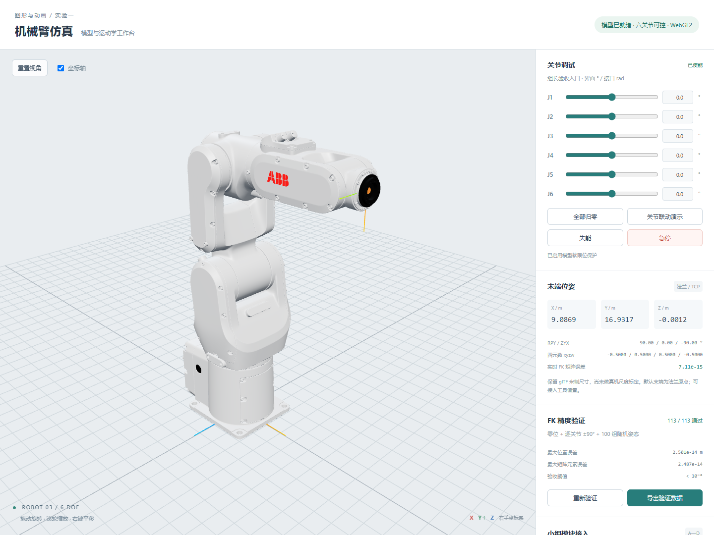

# 第 1 章 模型解析与正向运动学建模验证

负责角色：1 号位（组长）。验证日期：2026-10-23。

本章对应组长负责的模型导入、关节驱动、正向运动学（FK，由关节角计算末端位姿）和场景接入底座。代码由本次协作实现，数据来自实际运行，不代表组员已独立掌握或全组实验已全部完成。

## 1.1 模型与坐标约定

采用 public/models/robot3/robot_articulated.glb，包含六个运动关节和 11 个网格。GLB 的 SHA-256：

~~~text
3aae4cb60d3b1cda45bd8d5cddfd8046ffe04040e4b7c62b103b34cb4224569c
~~~

使用 Three.js 右手系，Y 向上；X/Y/Z 为红/绿/蓝轴。接口长度为米、角度为弧度，界面使用度，转换公式为 \(\theta_{\rm rad}=\theta_{\rm deg}\pi/180\)。

工程保留资产原始长度数值，按 1 资产单位 = 1 m 解释。资产没有可核验的真机尺寸标定，因此页面米数仅代表仿真尺度，不能当作 ABB 实物臂长。若后续调整尺度，需要重新提取参数，并重跑 FK 和工作空间分析。

模型导出时基座倒置。主场景用独立父节点绕 X 轴转 \(\pi\)，将 J1 的水平投影移到世界原点，并使模型最低点落在地面。固定摆放平移为：

~~~text
[-0.24909710884094238, -0.0020532852377671447, -0.10285765706901806] m
~~~

摆放四元数为 (1,0,0,0)，缩放为 (1,1,1)。这个固定变换计入 FK，而非只修改画面。

## 1.2 实际层级和参数来源

GLB 的实际运动链为：

~~~text
Scene → link_base → J1 → J2 → J3 → J4 → J5 → J6 → link_flange → tcp
~~~

各 link_1～link_6 外观网格分别挂在相应 J 节点下。相邻运动关节直接串联，不能按概念示意图中的“J1 → link_1 → J2”假定层级。构造 RobotModel 时检查六个节点唯一存在，且按顺序位于法兰祖先链中；缺失、重名或错误层级立即报错。

参数取舍如下：

1. 零位平移、零位四元数和法兰固定变换：以实际 GLB 为准，保留完整精度。
2. 关节轴和软限位：采用五人分工已指定的 joint_map.json。
3. GLB 的 extras.axis 全部写 Z，extras.limit 还是 JSON 字符串，不能据此把六个轴全部当 Z。
4. joint_map 内的 translation、rfix_quat_wxyz、dh.matrix 与 GLB 导出后的坐标并不完全一致，不替代实际零位参数，也不套用课件 UR5 的 DH 表。
5. 四元数存在 float32 舍入，加载后归一化；提取脚本采用相同处理。下面统一使用 xyzw 顺序。

关节轴定义在各自的**父坐标系**中：

| 关节 | 父系正轴 | 软限位 | GLB 零位平移 t / m | 归一化零位四元数 xyzw |
| --- | --- | --- | --- | --- |
| J1 | +Y | -180° ～ 180° | (-2.50198770, 4.68401766, -2.72359896) | (-0.70710690, 0.00000000, 0.70710666, 0.00000008) |
| J2 | +X | -120° ～ 120° | (-1.56886315, -5.20737314, 0.03381418) | (0.00000000, 0.00000000, 0.70710678, 0.70710678) |
| J3 | +Y | -120° ～ 120° | (-6.79437637, 0.00000000, -0.02465591) | (0.00000000, 0.00000000, 0.00000000, 1.00000000) |
| J4 | +Z | -180° ～ 180° | (-0.24375187, -1.57022321, -2.02229476) | (-0.70710678, 0.00000000, 0.00000000, 0.70710678) |
| J5 | +Z | -120° ～ 120° | (-0.00423907, 5.49846888, -0.95947117) | (0.70710678, 0.00000000, 0.00000000, 0.70710678) |
| J6 | +Z | -180° ～ 180° | (-0.00000896, 0.95961857, -1.57524824) | (-0.70710678, 0.00000000, 0.00000000, 0.70710678) |

表格为便于阅读而舍入，计算使用 src/robot/robot3Config.js 的完整精度。

## 1.3 齐次变换与 FK 推导

采用列向量，齐次矩阵左乘坐标：

\[
[p_W;1]={}^{W}T_F[p_F;1].
\]

W 为世界系，F 为法兰系，p 是对应坐标系下的三维坐标。矩阵左上为 3×3 旋转，右上为 3×1 平移，末行为 [0,0,0,1]。

设 \(t_i\) 为关节零位平移，\(R_i^0\) 为 GLB 零位旋转，\(a_i\) 为父坐标系中的单位旋转轴，\(\theta_i\) 为相对导出零位的弧度，则：

\[
A_i(\theta_i)=
\begin{bmatrix}
R(a_i,\theta_i)R_i^0&t_i\\0&1
\end{bmatrix}.
\]

轴定义在父系，因此运动旋转必须左乘零位旋转；平移不随该关节自身旋转。模型侧使用四元数 qMotion × qZero 更新，不能直接覆盖原始欧拉角或不断累加旋转。

数学侧采用 Rodrigues 公式：

\[
R(a,\theta)=\cos\theta I+(1-\cos\theta)aa^\mathsf{T}+\sin\theta[a]_\times.
\]

I 为单位矩阵，\([a]_\times v=a\times v\)。代码显式展开旋转矩阵，不读取当前场景节点作为 FK 输出。

令 P 为主场景固定摆放，B 为 link_base 固定变换，\(F_0\) 为 J6 到法兰的固定变换：

\[
{}^{W}T_F(\theta)=P\,B\,A_1(\theta_1)A_2(\theta_2)\cdots A_6(\theta_6)F_0.
\]

Scene 的单位变换也保留在代码的链中，没有省略基座或法兰固定旋转。Three.js 矩阵数组按列存储，Matrix4.set() 参数按行书写，代码区分这两种排列。

工具中心点 TCP 有偏置时：

\[
{}^{W}T_{\rm TCP}={}^WT_F\,{}^FT_{\rm TCP}.
\]

右侧是工具相对法兰的刚体变换，平移单位为米，由 B 的标定模块提供。省略工具偏置时按接口约定取法兰原点；素材自带 tcp 节点不会自动叠加，避免重复工具长度。

RPY 定义为 \(R=R_z(yaw)R_y(pitch)R_x(roll)\)，对应 ZYX 欧拉角顺序，输出单位为弧度；四元数归一化并按 xyzw 输出。RPY 在奇异位形可能不唯一，不能将数值跳变直接视为物体突变。

### 世界系与基座系

静态 Kinematics.forwardKinematics(q) 使用本工程默认工位，返回与 getTCPPose().matrixWorld 一致的**世界系末端矩阵**，供点云直接使用。若需要基座相对末端矩阵：

\[
{}^{B}T_F=({}^{W}T_B)^{-1}{}^{W}T_F.
\]

模型重新摆放后，用 new Kinematics(robot.getKinematicConfig()) 更新数值配置，不能继续用旧默认工位。单次 FK 只访问数值参数，不修改当前关节、不移动模型、不访问 DOM。

## 1.4 零位代入与独立复核

全零位时 \(R(a_i,0)=I\)，有：

\[
{}^{W}T_F(0)=P\,B\,A_1(0)\cdots A_6(0)F_0.
\]

逐段手算可使用递推：

\[
R_i=R_{i-1}R_i^0,\qquad p_i=p_{i-1}+R_{i-1}t_i.
\]

这里 \(R_{i-1}\) 是前一节点相对世界的旋转，\(p_i\) 为当前关节原点世界位置。不同局部坐标轴的平移不能直接逐项相加。

下表在独立 NumPy 脚本中从原始 GLB 逐段计算，没有导入 RobotModel 或 Kinematics，并与 Three.js 零位比较，作为可复算的手算核对表；不声称用户已亲手完成纸面计算。

| 节点 | 世界 X / m | 世界 Y / m | 世界 Z / m |
| --- | --- | --- | --- |
| link_base | 2.501987695694 | -0.002053285238 | 2.723599366552 |
| J1 | 0.000000000000 | 4.681964134891 | -0.000000000000 |
| J2 | -0.033814159250 | 9.889337250949 | 1.568863240912 |
| J3 | -0.009157529801 | 16.683713621616 | 1.568863378208 |
| J4 | 2.013137785326 | 16.927465304845 | -0.001359147540 |
| J5 | 7.511606985171 | 16.931703805422 | -0.960828459648 |
| J6 | 9.086854903037 | 16.931712582363 | -0.001209360094 |
| link_flange | 9.086854903037 | 16.931712582363 | -0.001209360094 |

零位法兰矩阵为：

~~~text
-1.06406501343e-07  -3.37174799414e-07  -1   9.08685490304
-1  -1.8983724869e-08   1.06406507744e-07   16.9317125824
-1.89837607466e-08   1  -3.37174797614e-07  -0.00120936009362
 0   0   0   1
~~~

旋转部分约为 [[0,0,-1],[-1,0,0],[0,1,0]]。这个近似只用于理解方向；验收使用完整精度，不用近似矩阵替换原始参数。

## 1.5 三档误差验证

模型侧：更新四元数后，读取法兰 matrixWorld。

数学侧：用静态零位参数、显式轴角矩阵和齐次变换连乘得到末端矩阵。两条路径共享资产几何定义，但采用不同计算路径。它们一致证明代码符合约定，不等于已经完成真机轴向和尺寸标定。

误差定义：

\[
e_p=\|p_{\rm FK}-p_{\rm scene}\|_2,\qquad
e_T=\max_{i,j}|T_{{\rm FK},ij}-T_{{\rm scene},ij}|.
\]

\(e_p\) 是米制位置距离；\(e_T\) 是 4×4 元素最大绝对差，属于混合旋转与平移的数值一致性指标，不作为独立物理距离。两项都必须小于 \(10^{-6}\)。

随机种子固定为 20261023，各关节在自身软限位区间内均匀采样。

| 类别 | 数量 | 最大位置误差 / m | 最大矩阵元素差 | 结果 |
| --- | --- | --- | --- | --- |
| 全零位 | 1 | 7.653295e-15 | 7.105427e-15 | 全部通过 |
| 单关节 ±90° | 12 | 1.438328e-14 | 1.421085e-14 | 全部通过 |
| 100 组随机姿态 | 100 | 2.500862e-14 | 2.486900e-14 | 全部通过 |

每次单关节测试的其余五个角都为零：

| 测试姿态 | 位置误差 / m | 矩阵最大元素差 |
| --- | --- | --- |
| J1-90 | 1.011e-14 | 7.105e-15 |
| J1+90 | 1.089e-14 | 1.066e-14 |
| J2-90 | 1.438e-14 | 1.421e-14 |
| J2+90 | 3.447e-15 | 2.665e-15 |
| J3-90 | 3.065e-15 | 2.665e-15 |
| J3+90 | 7.243e-15 | 7.105e-15 |
| J4-90 | 7.972e-15 | 7.105e-15 |
| J4+90 | 1.125e-14 | 1.066e-14 |
| J5-90 | 5.926e-15 | 5.329e-15 |
| J5+90 | 7.405e-15 | 7.105e-15 |
| J6-90 | 7.653e-15 | 7.105e-15 |
| J6+90 | 7.653e-15 | 7.105e-15 |

完整角度、坐标、误差和世界矩阵见 [113 组原始 JSON](组长材料/FK验证原始数据.json) 和 [CSV 数据表](组长材料/FK验证113组.csv)。

### 输入与边界检查

- 独立 NumPy 零位数值基准：通过。
- J1 正向 90° 符合基座 +Y 右手旋转：通过。
- 12 个上下软限位与返回数组隔离：通过。
- 非法输入原子拒绝，不污染现有关节状态：通过。
- 重复赋值 1000 次不累积零位旋转误差：通过。
- 工具偏置正确右乘，位置/旋转/四元数一致：通过。
- FK 对错误矩阵真实失败，不能虚报通过：通过。
- 纯数学 FK 调用不改变场景与当前关节值：通过。
- 重新摆放基座后，实例 FK 能正确更新世界坐标：通过。
- 缺关节、重复关节与错误层级立即报错：通过。

非法输入返回 success:false，并保持原状态；合法但超限时先钳制，再返回实际 clampedAngles 和提示。纯数学 FK 不隐式做限位修正，应传实际执行角。

## 1.6 主场景与实测画面

主入口已替换旧行星示例，显示真实机械臂、地网、坐标轴、TCP 标记、六关节调试入口、位姿看板、FK 验证和 JSON 导出。调试入口服务于组长验收，正式示教器仍由 A 完成。

联动按钮为基于真实帧间隔 \(\Delta t\) 的调试运动，不是 C 的 MOVJ 程序，也不作为连续示教任务已完成的证据。主循环使用 Three.js r186 的 Timer；Resize 同步更新 renderer 和相机比例。

实测环境：Windows、Node.js 24.20.0、Three.js r186、Vite 8.3.1、Edge / Playwright。实际开发地址为 http://127.0.0.1:5183/，其他电脑以终端输出为准。

- 真实 WebGL2、11 个模型网格及 113 组浏览器 FK：通过。
- 六关节角度输入、弧度换算与位姿刷新：通过。
- 超限数值钳制到 J2 +120°：通过。
- 关节滑块交互：通过。
- 急停冻结、禁用控件并拦截调用：通过。
- 复位后需重新使能且不自动恢复动作：通过。
- 113 组验证结果可从界面下载 JSON：通过。
- OrbitControls 鼠标旋转和滚轮缩放：通过。
- 测试替身：播放器最终帧、示教器反向同步、采样接口：通过。
- 1000×760 与 390×844 自适应、相机宽高比及无横向溢出：通过。
- 浏览器控制台 0 错误 / 0 警告，HTTP 失败 0：通过。

npm run build 通过。Vite 对约 650 kB 的入口包给出体积提示，这是包含 Three.js 的打包提示，与上面浏览器“0 警告”统计不同，当前不承诺生产环境加载性能。

## 1.7 与组员的交接边界

A 接收六关节弧度、当前位姿和滑块反向同步；B 获得法兰对象和工具偏置入口；C 通过唯一动画循环更新关节，最终帧不因 isMoving=false 丢失；D 获得纯数学 fkPosition 和真实位置/速度数据。渲染帧中累计采样间隔至少 20 ms，不宣称严格 50 Hz。

接入层用测试替身验证了回调、最终帧和数据采样；真实 A/B/C/D 文件目前仍为骨架，三点法、拾取流程、正式 MOVJ、轨迹图、点云分析和连续视频均待相应组员交付后联调。不能宣布四项作业全部完成。

详见 [组长实现与联调说明](../作业文档与分工/组长实现与联调说明.md)。

## 1.8 复现命令

~~~powershell
npm install
npm run dev
npm run verify:leader
npm run build
~~~

Vite 要求 Node.js ^20.19.0 或 >=22.12.0，本次验证使用 24.20.0。依赖已安装无需重复安装。只有模型参数需要重新生成时才运行 npm run robot:extract。
